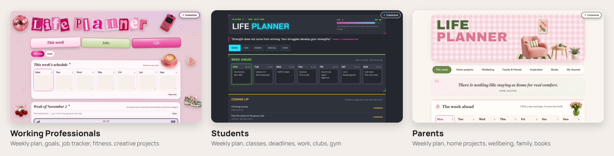
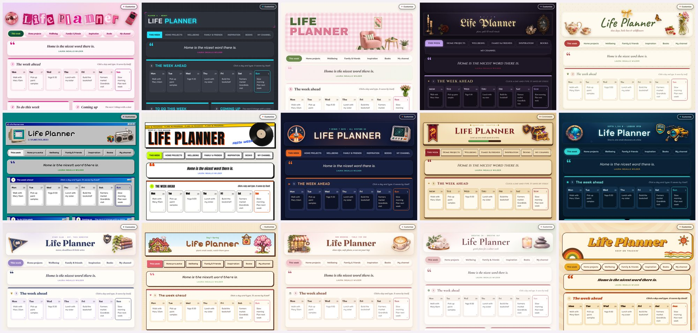

# Life Planner

A free, pretty planner for your week, your goals and the things you care about. Pick the planner for your stage of life, download one file and open it. No account, no install and no coding needed.

## Pick a planner

There are three planners, one for each stage of life. Each one starts with the tabs and examples that person needs.

| | Working Professionals | Students | Parents |
|---|---|---|---|
| **Built for** | Building a career: job hunting, goals and staying on top of a busy week | School or uni life: classes, deadlines, part-time work, clubs and friends | Running a home and family: projects around the house, wellbeing and the people you love |
| **What's inside** | A weekly plan, goals with a week-by-week roadmap, a job tracker with fit scores and charts, networking contacts, side projects, a profile, a fitness log and creative projects | A weekly plan, study sessions, deadlines and coming-up dates, shifts at work, clubs and friends, a gym log, an energy check-in with ideas for low days, and XP for ticking things off | A weekly plan with a daily quote, home project tracker, wellbeing and a mood journal, family and friends, inspiration, a book shelf, and a planner for a hobby or video channel |
| **File** | [`planners/girly-pop.html`](planners/girly-pop.html) | [`planners/arcade.html`](planners/arcade.html) | [`planners/studio.html`](planners/studio.html) |

Each planner is one file that works on its own, even with no internet. They only differ in how they **start**. Any planner can switch on any tab and wear any of the 15 themes, so pick the one closest to your life and make it yours.



## Use it in your browser (easiest)

1. Click the file for the planner you want in the table above, for example `planners/arcade.html` for Students.
2. Click the **Download raw file** button (the arrow pointing down, near the top right of the file).
3. Find the file in your Downloads folder and double-click it. It opens in your web browser.
4. Start typing. Everything saves by itself.

**Good to know**

- Your planner saves **inside that browser on that computer**. Open it the same way each time and your notes will be there.
- Move the file somewhere safe, like your Documents folder, and add a bookmark so it's one click away.
- Nothing you type is sent anywhere. There's no account, no tracking and no cloud. It stays on your computer.
- It works fully offline: the fonts, pictures and charts are all inside the file.
- Click **Start fresh** at the bottom to clear the example content in the planner's own tabs and make it yours.
- Want the examples back? **Restore default template design** adds the example content again without touching anything you've made.
- If a change ever fails to save (for example, the browser's storage is full or blocked in a private window), a yellow message pops up so you can export a backup straight away.

## Get a newer version

Your planner file never updates itself. That's on purpose: it never connects to the internet, so nothing you type can leave your computer. The version you have is shown at the bottom of your planner (for example, "Life Planner version 2.1.0").

To move to a newer version:

1. In your current planner, click **Export backup** and save the file somewhere private.
2. Download the new planner file from `planners/` (see [Use it in your browser](#use-it-in-your-browser-easiest)).
3. Open the new file and click **Import backup**, then pick your backup.
4. Check everything's there. If anything looks wrong, **Undo last import** puts it back.

If you open the new file **in the same browser** as the old one, your planner is usually already there, because both versions use the same saved data. The backup is your safety net either way.

### What's new in 2.1

- Seven new themes: Mission Control, RPG, Deep Sea, Study Club, Pixel, Cat Cafe and Spa, each with its own sticker art and a little animation.
- Dark Academia is gone (it was too close to Witchy). If you were using it, your planner switches back to its own theme and your content stays.
- Goth / Witchy is now called Witchy, and Desktop 93 is now Desktop.
- The ✦ Customize button sits at the top right, and the footer is tidier, with less-used actions under **More options**.
- Smaller text in the weekly phone list, and cleaner sticker cut-outs in every theme.

### What's new in 2.0

- Every planner can show every tab: pick yours with **✦ Customize**.
- Eight themes, from Girly Pop to 70s Groove, that you can switch between any time.
- Backups now cover everything, and you can move your planner between all three planners.
- Works fully offline: fonts, pictures and charts are inside the file.

## Choose your tabs

Tap the **✦ Customize** button in the bottom-right corner, then **Tabs**.

- Each tab has a switch. Turn it off to hide the tab, on to bring it back.
- **Hiding a tab never deletes anything.** Switch it back on and everything is exactly where you left it.
- **Add more tabs** lists the tabs from the other two planners, grouped by area (plans and goals, work and study, health, people, home, creative). Switch one on and it appears in your planner, with its own example content to get you started.
- You can't hide your very last tab, so your planner is never empty.
- **Back to the original tabs** goes back to the planner's starting tabs. Your content is kept.

## Switch themes

Tap **✦ Customize**, then **Themes**, and pick a card. Each card shows a small preview of that look.



Each planner starts in its own theme (Working Professionals in Girly Pop, Students in Arcade, Parents in Studio), and you can switch to any of these:

| Theme | The feel |
|---|---|
| Girly Pop | Y2K glam: chrome pinks, sparkles and stickers |
| Arcade | Dark neon HUD, pixel fonts and XP bars |
| Studio | Cosy Scandi home: gingham, birch and sage |
| Witchy | Candlelight, moon phases, crystals and blackletter |
| Cottagecore | Wildflowers, teatime, gingham bows and stitched edges |
| Desktop | Retro computer desk: bevelled windows, floppy disks, teal screen |
| Streetwear | Bold type, hard shadows, stickers and safety orange |
| Mission Control | Deep-space navy, launch orange, radar screens and mission patches |
| RPG | Quest log on parchment: gold trim, potions, treasure and a compass |
| Deep Sea | Bioluminescent blues, brass portholes, jellyfish and rising bubbles |
| Study Club | Watercolour library: lavender notebooks, navy crests and lattes |
| Pixel | Cosy pixel-art farm: cottages, cherry blossoms and sleepy pets |
| Cat Cafe | Latte tones, blush pink, sleepy cats and fresh pastries |
| Spa | Soft blush and sage, candlelight and jade rollers |
| 70s Groove | Sunshine stripes, daisies and big round shapes |

- Switching only changes the look. Your content and your tabs stay exactly the same, and you can switch as often as you like.
- Changed your mind? Tap **Undo** in the little message that pops up, or pick the planner's own theme (marked **Original**) to get its original look back exactly.

## Back up your planner

Your planner lives only in the browser where you use it. Clearing your browser history or "site data", or switching to a new computer, starts you from empty. A backup file keeps it safe.

- **Export backup** (in Working Professionals: **Backup & export**, then **Everything (JSON backup)**) downloads one `.json` file with everything in your planner, including the tabs you added and your theme. The footer shows when you last made one.
- **Import backup** brings a backup back, on the same computer or a new one. Before anything changes it shows what's in the file and lets you pick:
  - **Add to what I have**: keeps everything you have and adds anything from the backup that's missing.
  - **Replace with backup**: your planner becomes the backup; anything the backup doesn't cover stays as it is (tap twice to confirm).
  - **Cancel**: nothing changes.
- Every import first saves a copy of your planner as it was, so **Undo last import** puts it back exactly.
- **Moving between planners**: a backup from one planner can be imported into another. For example, import a Working Professionals backup into Students and its tabs appear in Students with your content in them. Your theme and tab choices stay as they are.
- Backups made with older versions of the planners still import.

Your backup file holds everything you typed, so keep it somewhere private, and never upload it anywhere public.

## Use it with Claude or another AI

You can also open your planner inside an AI chat and ask it to change things for you.

**Claude**

1. Download the file as above.
2. Start a new chat at [claude.ai](https://claude.ai) and attach the file.
3. Paste this, then add your own wishes:

```
Open this file as an artifact so I can use it here. Then personalise it for me:
- My name is ___.
- The areas of my life I want to plan are ___.
- Change the example content to things that fit my life: ___.
Keep the same look and keep everything saving in the browser.
```

**ChatGPT, Gemini or another AI**

Attach the file the same way and use the same message. If the AI can show a live preview (both ChatGPT and Gemini call it Canvas), ask it to open the file there. If it can only give you code back, ask it for the whole updated file, save it as something like `my-planner.html`, and double-click it to open it in your browser.

**Ideas for things to ask**

- "Rename the tabs to Work, Home, Health and Fun."
- "Add a section for my reading list."
- "Make the text bigger."
- "Change the pink to lavender."

## Files

- `planners/girly-pop.html`, `planners/arcade.html`, `planners/studio.html`: the planners to download. Each works on its own.
- `themes/`: the classic single-look versions of the three planners. They still work, and their backups import into the new planners.
- `src/`: the shared source the planners are built from (developers only):
  - `src/packs/`: the original planners' tabs, styles and code.
  - `src/themes/`: one folder per theme, with its colours, fonts, decorations and gallery preview.
  - `src/shell/`: the Customize panel, the theme gallery and the code that lets every planner show every tab.
  - `src/fonts/`, `src/assets/`, `src/vendor/`: fonts (SIL Open Font Licence), pictures and the chart library, built into each file so it works offline.
- `shared/backup-kit.html`: the backup, import and save-warning code that every planner shares.
- `tools/build.mjs`: builds `planners/` from `src/`.
- `tests/`: browser tests.

### For developers

```
npm install        # only needed for the tests
npm run build      # rebuild planners/ after changing src/ or shared/
npm run check      # fails if planners/ is out of date
npm test           # backup and planner tests in a real browser, offline
```

Edit the files in `src/`, never the files in `planners/` directly. Each planner keeps its original storage, so updating the file never touches what someone has already typed.

The example people, jobs and places in the files are made up.

Licensed under [MIT](LICENSE). Use it, change it, share it.
