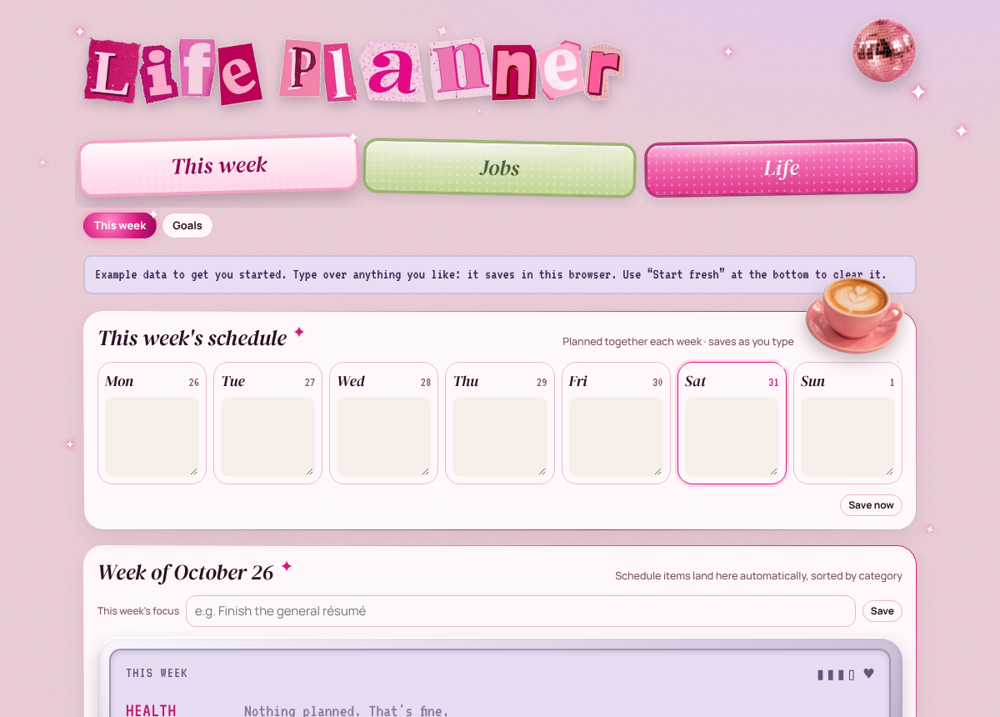
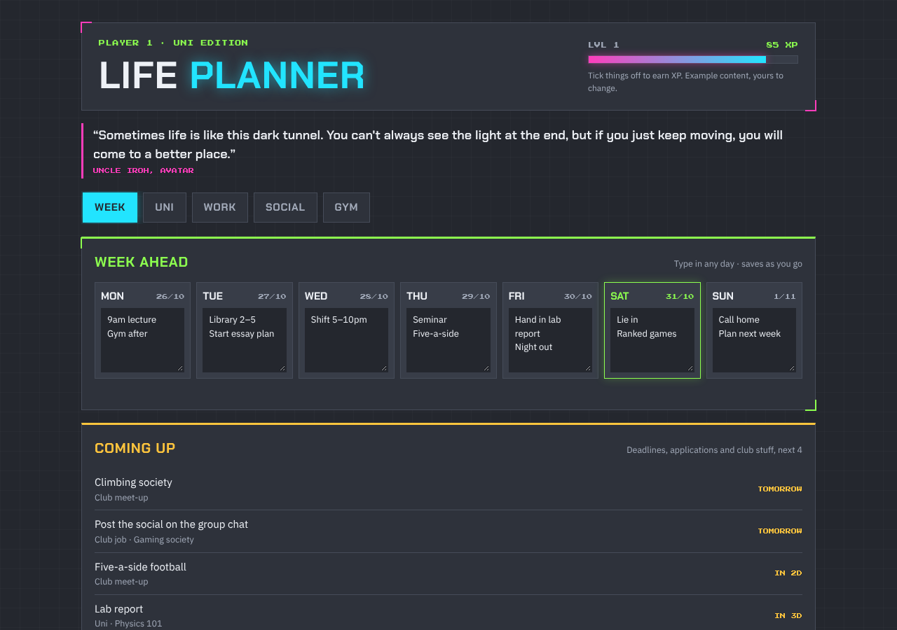
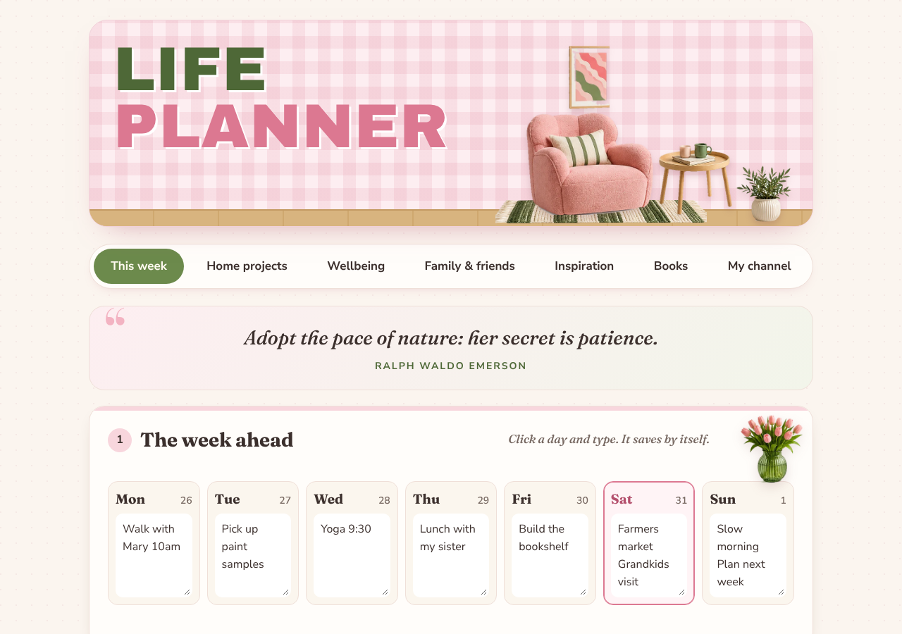
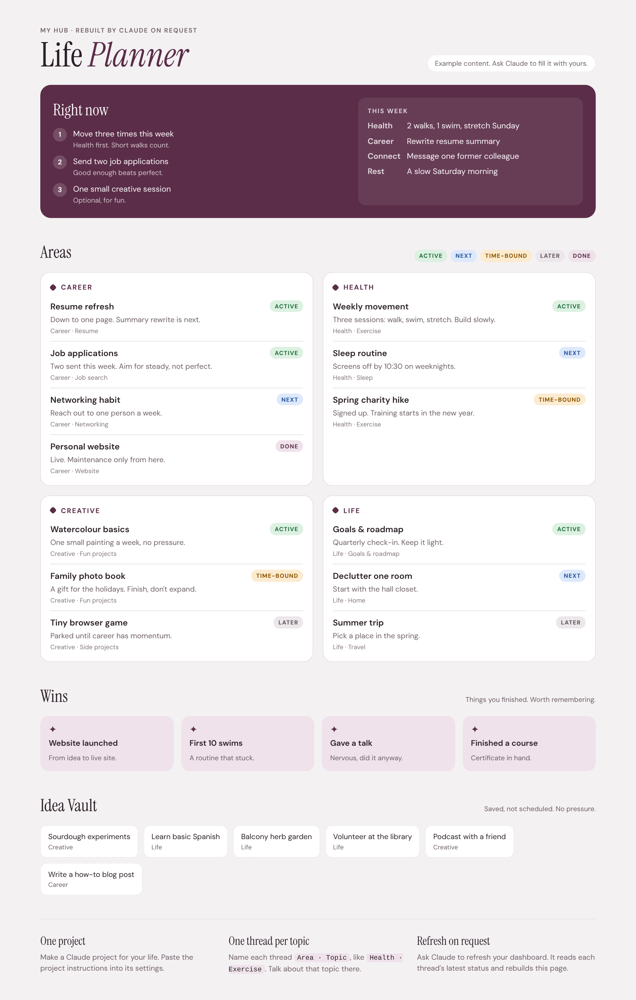

# Life Planner

A free, pretty planner for your week, your goals and the things you care about. Pick a look, download one file and open it. No account, no install and no coding needed.

## Pick a look

| Girly Pop | Arcade | Studio |
|---|---|---|
|  |  |  |
| Pink 2000s glam: cut-out letters, sparkles and a flip-phone screen. Tabs for your week, goals, job search, fitness and creative projects. | Dark gaming style with neon colours. Earn XP by ticking things off. Made for a student: week, uni deadlines, work, clubs and gym. | Refined and decor-loving: blush pink, sage green, cream and oak, with cosy decor pictures and big easy-to-read text. Week, home projects, wellbeing, family and friends, a colour mood board, wellbeing with walks, meditation and a journal, favourite quotes, a book tracker with covers and ratings, and a "My channel" tab for YouTube creators: posting calendar, video pipeline, watch later and favourite channels. |
| [`themes/girly-pop.html`](themes/girly-pop.html) | [`themes/arcade.html`](themes/arcade.html) | [`themes/studio.html`](themes/studio.html) |

Each one is a single file. They all have a 7-day week you can type into, lists you can tick off, and example content so you can see how it works.

## Use it in your browser (easiest)

1. Click the file for the look you want in the table above, for example `themes/studio.html`.
2. Click the **Download raw file** button (the arrow pointing down, near the top right of the file).
3. Find the file in your Downloads folder and double-click it. It opens in your web browser.
4. Start typing. Everything saves by itself.

**Good to know**

- Your planner saves **inside that browser on that computer**. Open it the same way each time and your notes will be there.
- Move the file somewhere safe, like your Documents folder, and add a bookmark so it's one click away.
- Clearing your browser history or "site data" can erase what you typed. Girly Pop has an **Export data** button at the bottom to save a backup.
- Nothing you type is sent anywhere. It stays on your computer.
- Click **Start fresh** at the bottom to clear the example content and make it yours.

## Use it with Claude or another AI

You can also open your planner inside an AI chat and ask it to change things for you.

**Claude**

1. Download the file as above.
2. Start a new chat at [claude.ai](https://claude.ai) and attach the file.
3. Paste this, then add your own wishes:

```
Open this file as an artifact so I can use it here. Then personalise it for me:
- My name is ___.
- The areas of my life I want to plan are ___.
- Change the example content to things that fit my life: ___.
Keep the same look and keep everything saving in the browser.
```

**ChatGPT, Gemini or another AI**

Attach the file the same way and use the same message. If the AI can show a live preview (both ChatGPT and Gemini call it Canvas), ask it to open the file there. If it can only give you code back, ask it for the whole updated file, save it as something like `my-planner.html`, and double-click it to open it in your browser.

**Ideas for things to ask**

- "Rename the tabs to Work, Home, Health and Fun."
- "Add a section for my reading list."
- "Make the text bigger."
- "Change the pink to lavender."

## Run your whole life admin with Claude (optional)

If you use Claude a lot, you can set up one Claude project as a personal hub, with one conversation per topic.

1. **One Claude project.** Create a project and paste the text from [`project-instructions.md`](project-instructions.md) into its instructions. Edit the areas and topics to fit your life.
2. **One thread per topic.** Name each thread `Area · Topic`, for example `Career · Resume` or `Health · Exercise`, so Claude always knows the latest status.
3. **Refresh on request.** Ask Claude to "refresh my dashboard". It reads each thread's latest status and rebuilds a summary page using [`dashboard.html`](dashboard.html) as the layout.



**Tags on the summary page:** `ACTIVE` (working on it now) · `NEXT` (up soon) · `TIME-BOUND` (has a deadline) · `LATER` (parked on purpose) · `DONE`.

## Files

- `themes/girly-pop.html`, `themes/arcade.html`, `themes/studio.html`: the planners. Each works on its own.
- `dashboard.html`: a one-page summary layout for the Claude project setup.
- `project-instructions.md`: starter instructions to paste into a Claude project.

The example people, jobs and places in the files are made up.

Licensed under [MIT](LICENSE). Use it, change it, share it.
