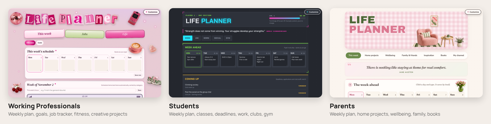
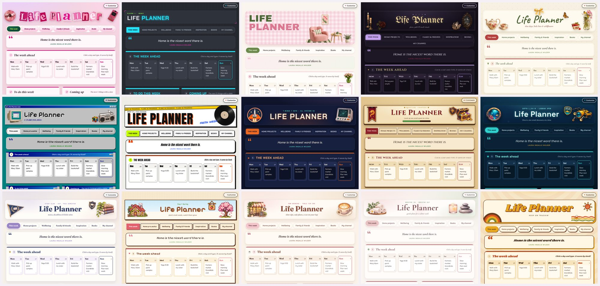

# Life Planner

A free, pretty planner for your week, your goals and the things you care about. It works on your phone or computer, with no account, no install and no tracking.

**Open a planner now:** [sabrinabedjera.github.io/life-planner](https://sabrinabedjera.github.io/life-planner/)



## Pick a planner

| | Working Professionals | Students | Parents |
|---|---|---|---|
| **Built for** | Job hunting, goals and a busy week | Classes, deadlines, shifts, clubs and friends | Home projects, wellbeing, family, books and a hobby channel |
| **Open it** | [Open](https://sabrinabedjera.github.io/life-planner/planners/working-professionals.html) | [Open](https://sabrinabedjera.github.io/life-planner/planners/students.html) | [Open](https://sabrinabedjera.github.io/life-planner/planners/parents.html) |
| **Download** | [`working-professionals.html`](planners/working-professionals.html) | [`students.html`](planners/students.html) | [`parents.html`](planners/parents.html) |

They only differ in how they start. Any planner can turn on any tab and use any of the 15 themes.

## Two ways to use it

| | **Open the link** (easiest) | **Download the file** |
|---|---|---|
| **Best for** | Phones, and keeping it simple | Computers, and working fully offline |
| **How** | Tap **Open** above, then bookmark it | Open the file, tap **Download raw file**, then double-click it |
| **Saving** | Saves by itself as you type | Saves by itself as you type |
| **Updates** | Automatic | Download the new file, then **Import backup** |

**On a phone?** You can add the link to your Home Screen so it opens like an app (iPhone: Share button → **Add to Home Screen**; Android: ⋮ menu → **Add to Home screen**). Then always open it from that icon.

## Keep your notes safe

Your notes are saved only on your device, in the browser (or Home Screen icon) you use. Nothing is ever sent anywhere. That also means clearing your browser data or getting a new phone or computer starts you from empty, and the link, the file and the icon each keep separate notes.

- **Export backup** (bottom of your planner) saves one small file with everything in it. Do this now and then, and keep the file private.
- **Import backup** brings it back, on any device or in any planner. It shows what's in the file first, and you choose to add to what you have or replace it. **Undo last import** puts things back.

## Make it yours

Tap **✦ Customize** at the top right.

- **Tabs:** switch tabs on or off. Hiding a tab never deletes anything. **Add more tabs** brings in tabs from the other planners.
- **Themes:** pick a look. Switching only changes the look, never your content.
- **Start fresh** at the bottom clears the example content. **Restore default template design** brings the examples back without touching your own.



## Use it with Claude or another AI

You can open your planner in an AI chat and ask it to change things for you. Download the file, start a new chat at [claude.ai](https://claude.ai) (or ChatGPT, Gemini and others), attach it, and paste:

```
Open this file as an artifact so I can use it here. Then personalise it for me:
- My name is ___.
- The areas of my life I want to plan are ___.
- Change the example content to things that fit my life: ___.
Keep the same look and keep everything saving in the browser.
```

Ideas to ask for: "Rename the tabs to Work, Home, Health and Fun", "Add a section for my reading list", "Make the text bigger".

<details>
<summary><b>All 15 themes</b></summary>

| Theme | The feel |
|---|---|
| Girly Pop | Y2K glam: chrome pinks, sparkles and stickers |
| Arcade | Dark neon HUD, pixel fonts and XP bars |
| Studio | Cosy Scandi home: gingham, birch and sage |
| Witchy | Candlelight, moon phases, crystals and blackletter |
| Cottagecore | Wildflowers, teatime, gingham bows and stitched edges |
| Desktop | Retro computer desk: bevelled windows, floppy disks, teal screen |
| Streetwear | Bold type, hard shadows, stickers and safety orange |
| Mission Control | Deep-space navy, launch orange, radar screens and mission patches |
| RPG | Quest log on parchment: gold trim, potions, treasure and a compass |
| Deep Sea | Bioluminescent blues, brass portholes, jellyfish and rising bubbles |
| Study Club | Watercolour library: lavender notebooks, navy crests and lattes |
| Pixel | Cosy pixel-art farm: cottages, cherry blossoms and sleepy pets |
| Cat Cafe | Latte tones, blush pink, sleepy cats and fresh pastries |
| Spa | Soft blush and sage, candlelight and jade rollers |
| 70s Groove | Sunshine stripes, daisies and big round shapes |

</details>

<details>
<summary><b>What's new</b></summary>

**Latest**
- Open any planner from a link, which is great on a phone.
- A Month calendar and Prev / Next week buttons in every planner.
- Parents: edit any entry, a stage dropdown for projects and videos, notes on each book, a video checklist, an ideas inbox and Undo.

**2.1**
- Seven new themes: Mission Control, RPG, Deep Sea, Study Club, Pixel, Cat Cafe and Spa.
- Files renamed by who they're for: `working-professionals.html` (was `girly-pop.html`), `students.html` (was `arcade.html`), `parents.html` (was `studio.html`). Old files keep working.

**2.0**
- Every planner can show every tab and wear every theme. Backups cover everything and move between planners. Works fully offline.

The version you have is shown at the bottom of your planner.

</details>

<details>
<summary><b>For developers</b></summary>

- `index.html`: the start page at [sabrinabedjera.github.io/life-planner](https://sabrinabedjera.github.io/life-planner/).
- `planners/`: the built planners. Each is one file that works on its own, fully offline.
- `themes/`: the classic single-look versions. Their backups import into the new planners.
- `src/`: the shared source. `src/packs/` has each planner's tabs and code, `src/themes/` the themes, `src/shell/` the Customize panel, and `src/fonts/`, `src/assets/`, `src/vendor/` the fonts (SIL Open Font Licence), pictures and chart library.
- `shared/backup-kit.html`: the backup, import and save-warning code every planner shares.
- `tools/build.mjs`: builds `planners/` from `src/` (`npm run build`). `tests/`: browser tests (`npm test`).

</details>
